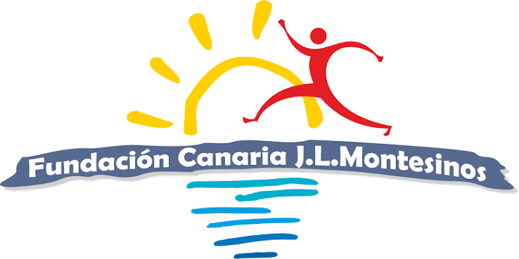

  
 <h1 align="center">Fundación Canaria José Luis Montesinos · Tecnología</h1> 
<strong>Puerto de la Cruz, Tenerife · Entidad sin ánimo de lucro desde 2014</strong>

# Fundación Canaria José Luis Montesinos · Tecnología

**Puerto de la Cruz, Tenerife · Entidad sin ánimo de lucro desde 2014**

La Fundación Canaria José Luis Montesinos es una entidad sin ánimo de lucro constituida en abril de 2014 y registrada en el Gobierno de Canarias. Desde Puerto de la Cruz acompaña a personas y familias en situación de vulnerabilidad, con un banco de alimentos y atención social sostenidos en gran parte por voluntariado.

Esta cuenta reúne el trabajo tecnológico de la Fundación: herramientas digitales, documentación técnica y proyectos que ayudan a que el equipo dedique menos tiempo a la burocracia y más a las personas.

---

## 🧭 Cómo trabajamos

- **Primero las personas, después la tecnología.** Las herramientas se diseñan junto a voluntarios y personal, a partir de lo que de verdad les pesa en el día a día.
- **Privacidad desde el diseño.** Trabajamos con datos de personas vulnerables. La seudonimización, el cifrado, el alojamiento en la UE y el cumplimiento del RGPD son requisitos de partida.
- **No recoger más de lo necesario.** Digitalizar un proceso no implica recoger datos nuevos. Pedimos lo mismo que antes, pero mejor protegido.
- **Despliegue progresivo.** Cada herramienta entra por fases, a medida que el equipo la adopta y la valida.
- **Documentación abierta.** Publicamos la documentación técnica para que otras entidades del tercer sector puedan aprender de lo que hacemos.

---

## 🛠️ Proyectos

| Proyecto | Qué es | Estado |
|---|---|---|
| **AnfitrIA** | Asistente de IA de la Fundación, con plataforma web para el equipo, canal de WhatsApp y apoyo al banco de alimentos y a la logística de reparto | En producción (fase 1) |

### Destacado: AnfitrIA

AnfitrIA es el proyecto tecnológico central de la Fundación. Actualmente ofrece una plataforma web de gestión para el equipo. En fases posteriores se añadirán el canal de WhatsApp (citas, recordatorios e información) y un módulo de voluntariado. También integra herramientas de apoyo: registro por voz para el control de stock del banco de alimentos, lectura de documentos y optimización de rutas de reparto.

📄 Documentación: [`anfitria_docs`](https://github.com/FC-JLM/anfitria_docs)

---

## 🤲 Colabora

¿Trabajas en tecnología, datos o protección de datos y quieres echar una mano? ¿Eres otra entidad social y te interesa reutilizar alguna de nuestras ideas? Nos encantará hablar contigo.

- 📍 Puerto de la Cruz, Tenerife (Islas Canarias)
- ✉️ `comunicacion@fundacionjoseluismontesinos.org`
- 🌐 `https://fundacionjoseluismontesinos.org/`
